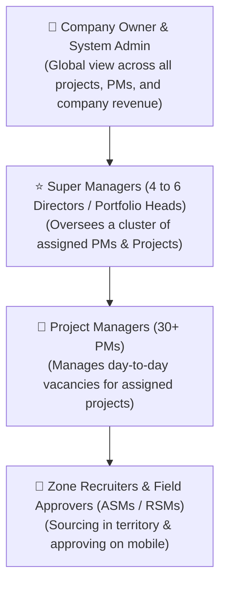
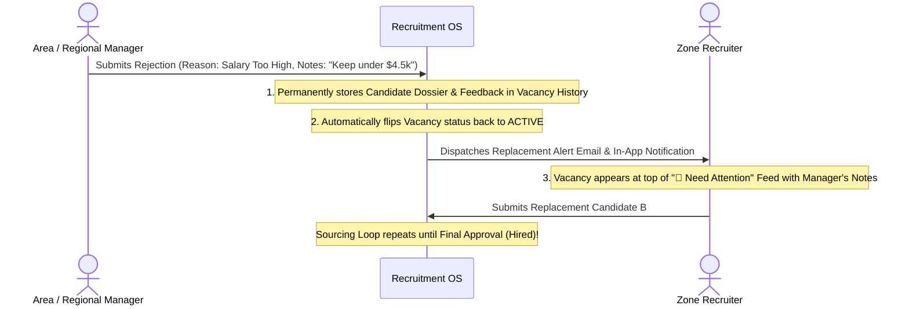

# 🎯 Smart Recruitment Lifecycle Tracker (Recruitment OS)
# Official Unified Product Blueprint & Design Document

---

## 📑 Table of Contents
1. [Executive Summary & Core Philosophy](#1-executive-summary--core-philosophy)
2. [Enterprise Hierarchy & Many-to-Many Mappings](#2-enterprise-hierarchy--many-to-many-mappings)
3. [Phase 1: Dynamic Project Roles & SLA Setup](#3-phase-1-dynamic-project-roles--sla-setup)
4. [Phase 2: Ingest, Area Approver Overrides & Deduplication](#4-phase-2-ingest-area-approver-overrides--deduplication)
5. [Phase 3: Recruiter Instagram-Style Social Feed & Profile](#5-phase-3-recruiter-instagram-style-social-feed--profile)
6. [Phase 4: Sourcing, 1-Click Mobile Approvals & Inaction Escalations](#6-phase-4-sourcing-1-click-mobile-approvals--inaction-escalations)
7. [Phase 5: Continuous Rejection Loop & Audit History](#7-phase-5-continuous-rejection-loop--audit-history)
8. [Phase 6: PM Flight Control Dashboard & Master Overrides](#8-phase-6-pm-flight-control-dashboard--master-overrides)

---

## 1. Executive Summary & Core Philosophy

The **Smart Recruitment Lifecycle Tracker (Recruitment OS)** is a purpose-built recruitment management platform tailored for high-velocity, distributed field and retail workforce hiring (e.g., FMCG brand promoters, retail merchandisers, territory supervisors).

### The Core Problem Solved
Traditional ATS systems are open-pool databases where hundreds of resumes sit in disorganized queues. In contrast, Recruitment OS treats hiring like a **Slot-Based Supply Chain**:
* Every open vacancy is a distinct, trackable requisition slot.
* **Strict Single-Candidate Rule**: Only **1 vetted candidate** occupies a slot at any time, preventing recruiter spam and candidate flooding.
* **Speed-Focused Approvals**: Field managers approve candidates in **5 seconds** via 1-click email actions on their mobile phones with zero password logins.
* **Continuous Sourcing Loop**: If a candidate is rejected, the slot automatically resets to `ACTIVE`, notifies the recruiter with structured feedback, and loops until successfully filled.

---

## 2. Enterprise Hierarchy & Many-to-Many Mappings

The organization supports massive scale: **1 Admin**, **1-2 Company Owners**, **4-6 Super Managers**, and **30+ Project Managers (PMs)** overseeing distributed Zone Recruiters and Field Approvers.



### Many-to-Many (M:N) Mapping Architecture

1. **Projects ↔ Project Managers (Many-to-Many)**:
   * A single Project *(e.g., Project Unilever)* can be assigned to multiple PMs *(e.g., David Chen and Sarah Connor)* for team collaboration or backup coverage.
   * A single PM can manage multiple Projects *(e.g., David Chen manages Unilever and P&G)*.
2. **Project Managers ↔ Super Managers (Many-to-Many)**:
   * A Super Manager oversees multiple PMs.
   * A PM working across multiple sectors can report to multiple Super Managers *(e.g., reporting to FMCG Director for Unilever and Beverage Director for Pepsi)*.
3. **Data Isolation & Scoped Visibility**:
   * **Company Owner & Admin**: Sees 100% of all data across the company.
   * **Super Manager**: Automatically filtered to only view the PMs and Projects in their cluster.
   * **Project Manager**: Only sees their assigned projects.
   * **Zone Recruiter**: Only sees active vacancies in their assigned geographic zone.

---

## 3. Phase 1: Dynamic Project Roles & SLA Setup

Every client project has distinct hiring requirements. Project Roles act as **Dynamic Job Blueprints**:

* **Free-Text Role Name**: 100% dynamic text input *(e.g., "Promoter", "F-Promoter", "Merchandiser", "Supervisor", "Beauty Advisor")* — no hardcoded restrictions.
* **Experience Requirement**: Custom text *(e.g., "Freshers / 0-1 Year", "2+ Years FMCG")*.
* **Salary Range / Budget**: Custom compensation *(e.g., "$3,500 - $4,200 / month", "$25 / hour")*.
* **Job Description**: Clear summary of duties on the ground.
* **PM Target Time-to-Fill (SLA / TAT)**:
  * PM sets expected fill window per role *(e.g., Merchandiser = 2 Days, Supervisor = 5 Days)*.
  * Drives live countdowns and urgency alerts across the platform.
* **Configurable Approval Tiers**:
  * PM defines whether this role requires **1 Level**, **2 Levels**, or **3 Levels** of sign-off.
  * Sets default approver emails *(Default ASM, Default RSM)*.

---

## 4. Phase 2: Ingest, Area Approver Overrides & Deduplication

### Ingesting Vacancy Requisitions
* **Method A (Single Ingest)**: PM selects project, project role, zone, area, and creates a slot.
* **Method B (Bulk Excel Upload)**: PM uploads multi-row spreadsheets using a standardized CSV/Excel template.

### The "Default vs. Excel Area Override" Rule
Different geographic areas have different local managers (e.g., Chicago Area Manager vs. Atlanta Area Manager).
* The Excel template includes columns for:
  `[Area]`, `[1st Approver Email]`, `[2nd Approver Email]`, `[3rd Approver Email]`.
* **System Logic**:
  * If the Excel row contains specific approver emails for that area → **Uses the area-specific emails**.
  * If left blank → **Automatically falls back to the default approver emails** defined in the Project Role.

### 4-Point Composite Deduplication
Before an ingested requisition is pushed live to recruiters, the system validates the 4-point composite key:
$$\text{Composite Key} = [\text{Project ID}] + [\text{Job Title}] + [\text{Zone}] + [\text{Area}]$$

* If an identical open/filled slot exists → Flagged as `DRAFT_DUPLICATE_FLAG`.
* If clean → Marked as `PENDING_INGEST_REVIEW`.
* **PM Queue Decisions (`/duplicates`)**:
  * **`SAME (Delete Duplicate)`**: Discards the duplicate upload permanently. No auto-incrementing vacancy ID is consumed.
  * **`DIFFERENT & APPROVE (Activate)`**: Confirms a valid parallel slot. Executes an atomic transaction:
    1. Increments project sequence counter (`currentSeq + 1`).
    2. Generates immutable vacancy code *(e.g., `UI003`)*.
    3. Stamps creation date & calculates SLA deadline.
    4. Routes to the active Zone Recruiter as `ACTIVE`.

---

## 5. Phase 3: Recruiter Instagram-Style Social Feed & Profile

To maximize recruiter speed and eliminate clunky spreadsheets, the recruiter interface is modeled after a **modern social media card feed**:

### The 3 Core Feed Tabs
1. 🚨 **Need Attention** *(Main Default Feed)*:
   * Brand new open slots requiring candidate sourcing.
   * Re-opened slots where a candidate was rejected and needs an immediate replacement.
2. ⏳ **In Process**:
   * Vacancies where a candidate has been submitted and is currently being evaluated by managers. Shows which approval level is pending.
3. ✅ **Completed**:
   * All successfully hired/filled positions (recruiter's historical archive).

### The Instagram-Style Vacancy Card Post
```text
┌──────────────────────────────────────────────────────────────┐
│  [🏢 Unilever Logo]  Project Unilever • #UI003               │
│  📍 North Zone — Chicago Metro                  [🔴 ACTIVE]  │
├──────────────────────────────────────────────────────────────┤
│  🎯 Beverage Brand Promoter                                  │
│  💵 Salary: $4,500 / month  •  ⏱️ 1-2 Years Exp             │
│                                                              │
│  📅 Created: Sep 7, 2026                                     │
│  🎯 PM Target: Fill within 2 Days                            │
│  ⏰ URGENCY: 🔥 Due Today (12 hours remaining!)              │
│                                                              │
│  📝 "Promote consumer beverages, sample products, audit      │
│      supermarket shelf positioning."                         │
│                                                              │
│  ⚠️ LAST REJECTION NOTE (From Area Manager):                 │
│  "Candidate lived 35 miles away. Must reside locally."       │
├──────────────────────────────────────────────────────────────┤
│  [ 🚀 SUBMIT CANDIDATE ]      [ 💬 View History Log (1) ]    │
└──────────────────────────────────────────────────────────────┘
```

### Urgency & Filtering Bar
Recruiters can filter their feed by:
* **Project** *(Unilever, P&G, etc.)*
* **Area / City** *(Chicago Metro, Detroit, etc.)*
* **Role Title** *(Promoter, Merchandiser, etc.)*
* **SLA Urgency** *(Due Today / Within 24-48h, Overdue / SLA Breached, Normal)*
* **Creation Date** *(Newest First / Oldest First)*

### Recruiter Instagram-Style Profile Page
When clicking on **"My Profile"**, the recruiter sees their personal performance scoreboard:
* **Avatar & Bio**: Name, Zone (e.g., *North Zone Recruiter*), Contact.
* **Key Stats Counter**:
  * `20` Active (To Source)
  * `4` In Process (Under Review)
  * `24` Completed (Hired 🎉)
* **KPI Metrics**: Overall Fill Rate %, Average Time to Fill (TAT).

---

## 6. Phase 4: Sourcing, 1-Click Mobile Approvals & Inaction Escalations

### Sourcing & Single-Candidate Guard
* Recruiter clicks **"Submit Candidate"** on an `ACTIVE` slot.
* Recruiter inputs: Full Name, Email, Phone, Experience Notes, Resume link.
* **Concurrency Guard**: The system locks the slot. If a candidate is under review, the button changes to `[ 🔒 Slot Locked — Review in Progress ]`. Multiple candidate submissions are blocked at the API level (HTTP 409).

### 1-Click Mobile Approver Experience (No Passwords)
Field managers (ASMs, RSMs) are busy and mobile. They receive an email with two prominent buttons:
1. **[ ✅ 1-CLICK APPROVE ]**:
   * Tapping this opens a mobile landing screen: *"Approval Recorded! Candidate advanced to next stage."*
   * Zero login required. Takes **5 seconds**.
2. **[ ❌ REJECT WITH FEEDBACK ]**:
   * Opens a dedicated 1-page mobile form requiring a **mandatory structured rejection reason** + optional comments.

### 48-Hour Reminder & Inaction Escalation Workflow
To ensure no candidate sits in limbo:

```text
[Day 0: Candidate Submitted]
  ↳ Email #1 dispatched to Approver with single-use secure token.
        │
        ▼ (48 Hours / 2 Days Silence)
[Day 2: Automatic Reminder (Attempt 2)]
  ↳ Approver receives Reminder Email with fresh single-use link:
    "⚠️ Action Required: Reminder for John Doe (#UI003)"
        │
        ▼ (Another 48 Hours / 2 Days Silence)
[Day 4: Escalation Alert (Inaction Trigger)]
  ↳ Still NO RESPONSE after 2 reminder cycles!
  ↳ System automatically dispatches alert notifications to:
    1. 💼 Project Manager (PM):
       "🚨 URGENT: ASM (david.asm@...) silent for 4 days on #UI003. Intervene immediately."
    2. 🎯 Zone Recruiter:
       "⚠️ Review Delayed: Approver unresponsive for 4 days."
```

---

## 7. Phase 5: Continuous Rejection Loop & Audit History

When an approver rejects a candidate, the requisition **never dies**. It initiates an automated recovery loop:



### Stored Audit Trail
For every candidate attempt on a vacancy slot, the system permanently records:
* Candidate Name, Contact, and Resume.
* Decision level (Level 1 PM, Level 2 ASM, Level 3 RSM).
* Reviewer Email.
* Structured Rejection Reason:
  * `SALARY_MISMATCH`: Compensation requested exceeds approved budget.
  * `EXPERIENCE_LACK`: Insufficient relevant field experience.
  * `LOCATION_UNWILLING`: Unwilling or unable to travel to assigned store.
  * `SKILL_GAP`: Language or domain competency gap.
  * `CULTURE_FIT`: Organizational misalignment.
* Reviewer's feedback comments.
* Exact date and timestamp.

---

## 8. Phase 6: PM Flight Control Dashboard & Master Overrides

The **Project Manager Dashboard** functions as an operational flight control tower for all assigned projects:

### Key Sections:
1. **Pulse KPIs**:
   * **Overall Fill Rate %**: Across assigned projects *(e.g., 84% - 210/250 Filled)*.
   * **Active Sourcing**: Total slots currently open.
   * **In Process**: Total candidates undergoing L1/L2/L3 review.
   * **Escalations & Bottlenecks**: Total managers silent for 4+ days.
2. **Action Attention Banners**:
   * Flagged duplicate ingests awaiting review.
   * Escalated unresponsive managers *(with 1-click override or contact buttons)*.
3. **Zone & Recruiter Comparative Scorecard**:
   * Compares North vs. South vs. East vs. West zones.
   * Tracks Average Time to Fill (TAT) against PM target SLAs.
4. **Master Emergency Overrides**:
   * **⚡ Force Fill**: Instantly marks slot as `FILLED` (e.g., offline client verbal hire).
   * **🛑 Cancel Slot**: Cancels requisition if client drops store location.
   * **🔄 Reassign Recruiter / Approver**: Seamlessly redistributes workload if a team member is absent.

---

## 📝 Document Status & Next Steps
* **Document Version**: 1.0 (Official Unified Blueprint)
* **Approved By**: Product Owner & Architecture Team
* **Implementation Plan**: Phased, modular roll-out starting with Phase 1 Dynamic Role & Many-to-Many entity configurations.
