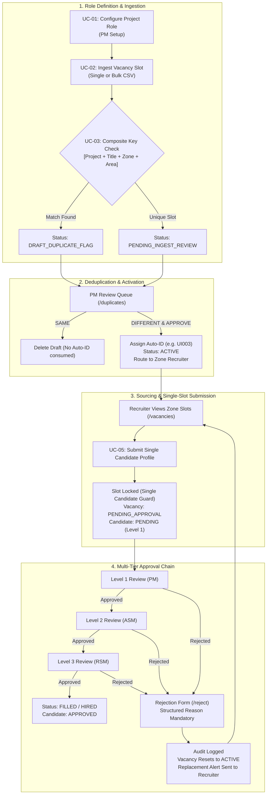

# 🎯 Smart Recruitment Lifecycle Tracker (Recruitment OS)
## System Overview & Use Case Specification

---

## 1. Executive Summary & Core Concept

The **Smart Recruitment Lifecycle Tracker (Recruitment OS)** is a domain-specific workforce management system engineered specifically for high-volume, multi-tier field and retail hiring (e.g., FMCG brand promoters, retail merchandisers, territory team leads).

Traditional Applicant Tracking Systems (ATS) rely on open candidate pools where dozens of applicants sit in unmanaged queues. In contrast, **Recruitment OS** enforces a disciplined **Slot-Based Sourcing Model**:
1. **Requisition Deduplication**: Prevents duplicate hiring slots before sourcing commences using a 4-point composite key (`[Project] + [Job Title] + [Zone] + [Area]`).
2. **Two-Step Setup & Sequential Code Generation**: Standard job templates are defined first; individual vacancies only receive official, immutable sequence IDs (e.g., `UI001`, `PG002`) after Project Manager validation.
3. **Strict Single-Candidate Constraint**: Only **1 vetted candidate** can be active in an open vacancy slot at any given moment. Concurrent candidate flooding is blocked at the database and API level.
4. **Automated Multi-Tier Approval Chain**: 3-level escalation (**L1 PM → L2 ASM → L3 RSM**) using secure, single-use, 1-click tokenized email workflows.
5. **Automated Rejection Reset & Sourcing Loops**: Structured rejections immediately invalidate pending tokens, log audit trails, reset the vacancy status back to `ACTIVE`, and alert the assigned Zone Recruiter to source an immediate replacement.

---

## 2. Identified Discrepancies & Corrections in Prior Draft

| Component / Parameter | Previous Draft Text | Correct System Implementation | Impact / Rationale |
| :--- | :--- | :--- | :--- |
| **Recruiter South Email** | `recruiter.south@recruiter.local` | `recruiter.south@recruitment.local` | Domain typo in draft prevented login. |
| **Credential Formatting** | Concatenated strings (e.g., `admin@...Admin@...`) | Standardized email / password credentials | Resolved authentication parsing ambiguity. |
| **Approval Hierarchy** | "Email-driven L1/L2 approval" | **3-Tier Approval Workflow**: **L1 (PM)** → **L2 (ASM)** → **L3 (RSM)** | Complete corporate governance chain; hiring occurs only after L3 sign-off. |
| **Vacancy Post-Submission Status** | "Vacancy status moves to `SUBMITTED`" | Vacancy moves to **`PENDING_APPROVAL`**; Submission is **`PENDING`** | Accurately reflects database state machine. |
| **Approval Landing URLs** | Static `/approve` and `/reject` | Tokenized: `/approve?token=...` and `/reject?token=...` | Endpoints require cryptographic JWT nonces for single-use security. |
| **PM Ingest Queue Actions** | "Approve / Activate" | **`SAME`** (Delete Duplicate) vs **`DIFFERENT & APPROVE`** (Assign ID & Activate) | Differentiates between removing invalid duplicates and creating distinct slots. |

---

## 3. System Actors & Access Matrix

| Actor | Seed Credentials | Primary Scope & Access |
| :--- | :--- | :--- |
| 👑 **Super Admin** | `admin@recruitment.local` `Admin@123456` | Full platform administration, system settings (`/settings`), user creation, role permission management, master overrides, and global analytics (`/`). |
| 💼 **Project Manager (PM)** | `pm.unilever@recruitment.local` `Pm@123456` | Step 1 project role configuration (`/project-roles`), Step 2 single & bulk CSV ingest (`/vacancies`), deduplication triage (`/duplicates`), L1 candidate approval, and vacancy overrides (`/vacancies`). |
| 🎯 **Zone Recruiter (North)** | `recruiter.north@recruitment.local` `Recruiter@123456` | Sourcing execution strictly scoped to **North Zone**. Submits 1 vetted candidate per open slot (`/vacancies`). |
| 🎯 **Zone Recruiter (South)** | `recruiter.south@recruitment.local` `Recruiter@123456` | Sourcing execution strictly scoped to **South Zone**. Submits 1 vetted candidate per open slot (`/vacancies`). |
| ✉️ **Approvers (L1 / L2 / L3)** | L1: PM (`pm.unilever@...`) L2: ASM (`asmEmail`) L3: RSM (`rsmEmail`) | External/Internal decision-makers who review candidate submissions via secure 1-click email actions (`/approve`, `/reject`) without requiring manual portal logins. |

---

## 4. End-to-End System Use Cases

---

### Phase 1: Requisition Definition & Ingestion

#### **UC-01: Master Project Role Configuration**
- **Primary Actor:** Project Manager (PM)
- **Preconditions:** Project entity exists with client prefix code (e.g., `UI` for Unilever, `PG` for P&G).
- **Trigger:** PM navigates to `/project-roles` and initiates role creation.
- **Workflow:**
  1. PM selects a system `BaseRole` (Promoter, Merchandiser, or Team Lead).
  2. PM defines custom job title, standard compensation package (e.g., `$4,500 / month`), and experience criteria (e.g., `1-2 Years Field Experience`).
  3. PM designates approver escalation routing by assigning Area Sales Manager (ASM) and Regional Sales Manager (RSM) notification emails.
  4. System saves the configuration under the associated project template.
- **Outcome:** Master role blueprint is established for consistent vacancy creation.

#### **UC-02: Vacancy Requisition Ingestion (Single & Bulk CSV)**
- **Primary Actor:** Project Manager (PM) / Super Admin
- **Preconditions:** Active Project and Project Role blueprints exist.
- **Execution Paths:**
  - **Path A (Single Ingest):** PM selects project role, selects Zone (`North`, `South`, etc.), enters specific Area/Territory, and submits.
  - **Path B (Bulk CSV Upload):** PM downloads the standard CSV template (`/api/v1/vacancies/csv-template`), uploads multi-row requirements, and submits for batch processing.
- **Business Rule:** Requisitions ingested at this stage **do not receive a Vacancy ID** and cannot be sourced yet. They enter the pipeline in staging status.

#### **UC-03: Composite Deduplication & Ingest Review**
- **Primary Actor:** Project Manager (PM)
- **Preconditions:** Ingested requisitions exist in staging queue (`/duplicates`).
- **Composite Key Evaluator:**
  $$\text{Composite Key} = [\text{Project ID}] + [\text{Job Title}] + [\text{Zone}] + [\text{Area}]$$
- **Workflow:**
  1. System checks for existing open/filled requisitions matching the 4-point composite key.
  2. If an identical active requisition exists, system flags the new record as `DRAFT_DUPLICATE_FLAG`.
  3. If unique, record is marked as `PENDING_INGEST_REVIEW`.
  4. PM reviews the queue and chooses one of two decisions:
     - **`SAME (Delete Duplicate)`**: The requisition is recognized as an accidental duplicate upload and is purged. No sequence ID is consumed.
     - **`DIFFERENT & APPROVE (Activate)`**: The requisition represents an intentional parallel opening in the same area. The system executes an atomic transaction:
       - Increments the project's sequence counter (`currentSeq + 1`).
       - Generates an immutable, human-readable Vacancy Code (e.g., `UI003`).
       - Auto-assigns the vacancy to the active Zone Recruiter for that territory.
       - Flips status to `ACTIVE`.

---

### Phase 2: Sourcing & Candidate Pipeline

#### **UC-04: Zone-Filtered Requisition Sourcing**
- **Primary Actor:** Zone Recruiter (`recruiter.north@...`, `recruiter.south@...`)
- **Preconditions:** Recruiter is authenticated.
- **Workflow:**
  1. Recruiter accesses `/vacancies`.
  2. The system queries recruiter territory data and automatically filters vacancies to their designated zone (e.g., Recruiter North only sees North vacancies).
  3. Recruiter identifies vacancies in `ACTIVE` state requiring talent acquisition.

#### **UC-05: Strict Single-Candidate Submission**
- **Primary Actor:** Zone Recruiter
- **Preconditions:** Vacancy is in `ACTIVE` status with no existing active candidates.
- **Workflow:**
  1. Recruiter clicks **"Submit Candidate"** on an `ACTIVE` vacancy.
  2. Recruiter enters candidate details: Full Name, Email, Phone, Resume Reference.
  3. Upon submission:
     - System validates that no other candidate is currently active (`PENDING` or `APPROVED`) for this vacancy.
     - Candidate submission record is created with `currentLevel: 1` and `status: PENDING`.
     - Vacancy status transitions immediately to **`PENDING_APPROVAL`**.
     - System generates a 72-hour single-use cryptographic JWT token nonce.
     - BullMQ enqueues a Level 1 review request email to the PM.
- **Concurrency Guard:** The "Submit Candidate" button is locked (`Slot Occupied`) for other users. Any concurrent submission attempts receive an HTTP 409 Conflict.

---

### Phase 3: Approval Escalation & Hiring

#### **UC-06: Asynchronous Multi-Tier Approval Chain**
- **Primary Actors:** Level 1 (PM) → Level 2 (ASM) → Level 3 (RSM)
- **Workflow:**
  1. **Level 1 (Project Manager):**
     - PM receives email containing candidate dossier and 1-click tokenized actions.
     - PM clicks **Approve** (`/approve?token=...`).
     - System validates token nonce (ensuring not used/expired), logs audit trail, advances candidate to `currentLevel: 2`, generates Level 2 token, and enqueues notification email to ASM.
  2. **Level 2 (Area Sales Manager):**
     - ASM clicks **Approve** from their email.
     - System validates token, logs audit trail, advances candidate to `currentLevel: 3`, generates Level 3 token, and enqueues notification to RSM.
  3. **Level 3 (Regional Sales Manager):**
     - RSM clicks **Approve** from their email.
     - System validates token, marks candidate submission as **`APPROVED`**, and updates Vacancy status to **`FILLED`**.
     - Final onboarding state is achieved.

#### **UC-07: Structured Candidate Rejection & Sourcing Reset**
- **Primary Actors:** Any Approver (L1 PM, L2 ASM, or L3 RSM)
- **Preconditions:** Candidate is currently pending review at that approver's level.
- **Workflow:**
  1. Approver clicks **Reject with Reason** from notification email.
  2. Approver is directed to secure web form (`/reject?token=...&vacancyCode=...`).
  3. Approver selects mandatory structured rejection reason:
     - `SALARY_MISMATCH`: Compensation expectations exceed role budget.
     - `EXPERIENCE_LACK`: Insufficient domain or field experience.
     - `LOCATION_UNWILLING`: Unwilling to relocate or service assigned area.
     - `SKILL_GAP`: Technical or retail competency shortfall.
     - `CULTURE_FIT`: Organizational misalignment.
  4. Approver provides optional contextual comments and submits.
  5. **System Execution:**
     - Token is immediately invalidated.
     - Submission status updated to `REJECTED`.
     - Comprehensive entry logged in `approval_audits` with level and reviewer email.
     - **Automated State Reset**: Vacancy status is immediately reset from `PENDING_APPROVAL` back to **`ACTIVE`**.
     - BullMQ enqueues a high-priority replacement notification to the assigned Zone Recruiter with feedback notes so sourcing can immediately recommence.

---

### Phase 4: Governance & Intelligence

#### **UC-08: Master PM / Admin Overrides**
- **Primary Actor:** Project Manager / Super Admin
- **Scope:** Emergency interventions directly on the Vacancies table (`/vacancies`).
- **Available Actions:**
  - **Force Fill (`POST /api/v1/overrides/force-fill`)**: Manually marks a requisition as `FILLED` (e.g., internal lateral transfer or client direct hire).
  - **Cancel Requisition (`POST /api/v1/overrides/cancel`)**: Closes the slot and marks status as `CANCELLED`.
  - **Delete Requisition (`DELETE /api/v1/overrides/:id`)**: Permanently removes corrupted or obsolete records from database.

#### **UC-09: Real-time Operational KPI Dashboard**
- **Primary Actor:** Super Admin / Project Manager
- **Interface:** `/` (Workforce Operations Dashboard)
- **Real-time Metrics:**
  - **Active Requisitions**: Open slots currently requiring recruiter sourcing.
  - **Pending Approvals**: Candidates actively undergoing L1-L3 review.
  - **Filled Positions**: Total successfully hired roles.
  - **Rejections & Sourcing Resets**: Total candidates rejected and returned to pipeline.
  - **Duplicate Alert Banners**: Immediate visibility into composite duplicate flags awaiting PM review.

#### **UC-10: System Administration & User Governance**
- **Primary Actor:** Super Admin
- **Interface:** `/settings`
- **Capabilities:**
  - Create internal platform users with encrypted credentials.
  - Assign system roles (`SUPER_ADMIN`, `PM`, `RECRUITER`).
  - Configure territory assignments (Zone mapping).
  - Toggle user activation status (instantly revoking access).
